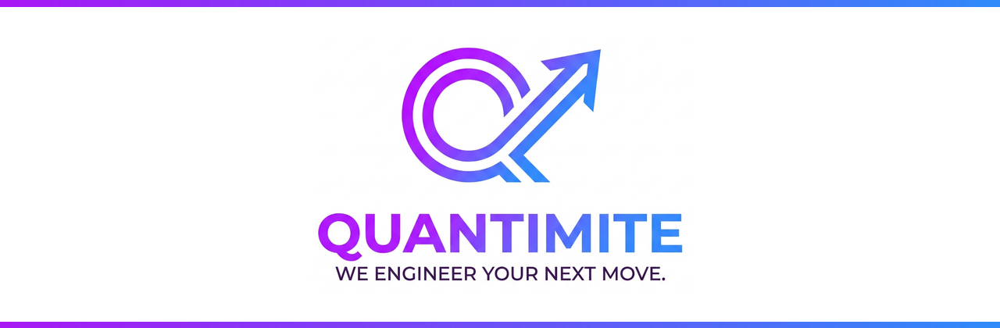
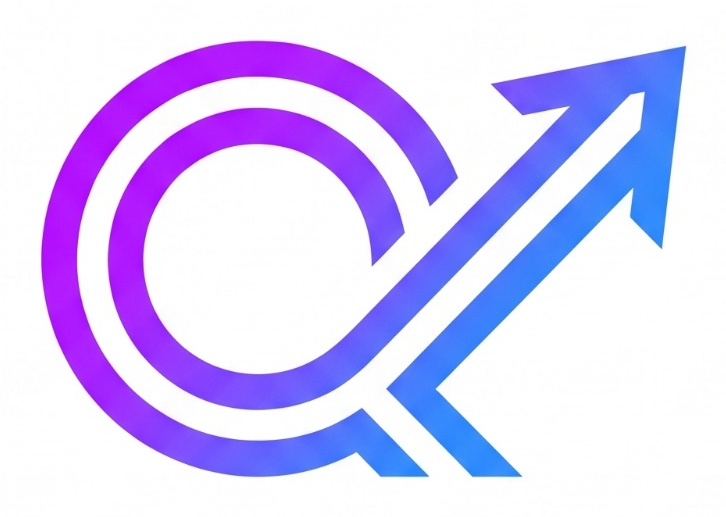

<div align="center">



<br />

# Quantimite Website

**Digital products, software solutions, and growth strategies designed to help businesses move forward.**

<br />


[Overview](#-overview) •
[Features](#-features) •
[Pages](#-pages) •
[Tech Stack](#-tech-stack) •
[Getting Started](#-getting-started) •
[Roadmap](#-roadmap) •
[Contact](#-contact)

</div>

---

## 📖 Overview

**Quantimite** is a technology and digital growth partner that brings together **software engineering**, **product design**, and **digital marketing**. This repository contains the source code for the official Quantimite website, which presents our services, showcases our work, and helps businesses start their next project with us.

> *Thoughtful work. Clear communication. A commitment to quality.*

### What we do

| Software Development & Engineering | Digital Marketing & Growth |
| --- | --- |
| Custom web and mobile applications | Performance marketing and paid media |
| Enterprise software and SaaS | Search engine optimisation (SEO) |
| UI/UX and product design | Brand identity and creative production |
| API development and integration | Social media strategy and management |
| Cloud, DevOps, and maintenance | Marketing automation and email |

### Our approach

**Understand** → **Plan** → **Create** → **Improve**

---

## ✨ Features

### Functional

- **Service showcase** with dedicated pages for software and digital growth services
- **Portfolio and case studies** with filtering by category
- **Project inquiry form** with service, budget, and timeline fields
- **Free consultation booking** through a calendar integration
- **Careers portal** with open positions, internships, and an application form
- **Research hub** for publications, whitepapers, and R&D projects
- **Blog / Insights** with categories, tags, and search
- **Newsletter signup**
- **Admin dashboard (CMS)** to manage blog posts, portfolio items, jobs, and research
- **Analytics integration** (Google Analytics, Meta Pixel, Search Console)

### Non-functional

| Area | Goal |
| --- | --- |
| **Performance** | Load time under 3 seconds, optimised images, lazy loading, CDN delivery |
| **Responsiveness** | Mobile-first layout for phones, tablets, and desktops |
| **SEO** | Clean URLs, meta tags, structured data, and a sitemap |
| **Security** | HTTPS, input validation, spam protection, rate limiting |
| **Accessibility** | WCAG-aligned colour contrast, keyboard navigation, and alt text |
| **Reliability** | High-uptime hosting, automated backups, error monitoring |
| **Scalability** | Modular architecture that supports future features |
| **Maintainability** | Clean, documented code with CI/CD deployment |

---

## 🗺️ Pages

| Page | Purpose |
| --- | --- |
| **Home** | Introduce Quantimite, highlight services, and drive visitors to act |
| **About Us** | Share our story, values, approach, and team |
| **Services** | Overview of software and digital growth offerings, with a detail page for each pillar |
| **Portfolio** | Case studies that demonstrate our work |
| **Research** | Publications, whitepapers, and R&D projects |
| **Blog / Insights** | Articles on software, design, and marketing |
| **Careers** | Open positions, internships, and applications |
| **Contact** | Inquiry form and consultation booking |
| **Legal & Support** | FAQ, Privacy Policy, Terms of Service, Cookie Policy, and 404 page |

---

## 🧰 Tech Stack

| Layer | Technology |
| --- | --- |
| **Framework** | [Next.js](https://nextjs.org/) (React) |
| **Language** | [TypeScript](https://www.typescriptlang.org/) |
| **Styling** | [Tailwind CSS](https://tailwindcss.com/) |
| **Content / Data** | Headless CMS (Sanity or Strapi) or [Supabase](https://supabase.com/) |
| **Hosting** | [Vercel](https://vercel.com/) |
| **Integrations** | Calendly / Cal.com, Mailchimp, Google Analytics |

> Update this table to match the technologies you finally choose.

---

## 🚀 Getting Started

### Prerequisites

- [Node.js](https://nodejs.org/) 18 or later
- [Git](https://git-scm.com/)
- npm, yarn, or pnpm

### Installation

```bash
# 1. Clone the repository
git clone https://github.com/<your-username>/<your-repo>.git

# 2. Move into the project folder
cd <your-repo>

# 3. Install dependencies
npm install

# 4. Create your environment file
cp .env.example .env.local

# 5. Start the development server
npm run dev
```

Open [http://localhost:3000](http://localhost:3000) in your browser.

### Environment variables

Create a `.env.local` file in the project root:

```env
NEXT_PUBLIC_SITE_URL=http://localhost:3000
NEXT_PUBLIC_GA_ID=
CONTACT_EMAIL=
CMS_API_KEY=
```

### Available scripts

| Command | Description |
| --- | --- |
| `npm run dev` | Start the development server |
| `npm run build` | Create a production build |
| `npm run start` | Run the production build |
| `npm run lint` | Check code quality |

---

## 📁 Project Structure

```text
.
├── assets/             # README images and brand assets
├── public/             # Static files (images, fonts, icons)
├── src/
│   ├── app/            # Pages and routes
│   ├── components/     # Reusable UI components
│   ├── lib/            # Helpers and integrations
│   └── styles/         # Global styles
├── .env.example        # Example environment variables
├── package.json
└── README.md
```

> Adjust this structure to match your actual project layout.

---

## 🎨 Brand Guidelines

<table>
  <tr>
    <td align="center"></td>
    <td>
      <b>Brand colours</b><br /><br />
      
      
      
      <br /><br />
      <b>Signature look:</b> a purple-to-blue gradient<br />
      <b>Tagline:</b> <i>We Engineer Your Next Move.</i>
    </td>
  </tr>
</table>

Logo files are available in the [`assets`](assets) folder. Please do not alter or recolour the logo.

---

## 🛣️ Roadmap

- [x] Brand identity and services profile
- [ ] **Phase 1 (MVP):** Home, About, Services, Contact form, basic SEO, legal pages
- [ ] **Phase 2:** Portfolio, blog, consultation booking, Careers page, Research page, analytics
- [ ] **Phase 3:** Client portal, project estimator, AI chatbot, multi-language support

---

## 🤝 Contributing

Contributions from the team are welcome.

1. Fork the repository
2. Create a feature branch: `git checkout -b feature/your-feature`
3. Commit your changes: `git commit -m "Add your feature"`
4. Push to the branch: `git push origin feature/your-feature`
5. Open a Pull Request

Please keep code clean, readable, and tested where possible.

---

## 📄 License

Distributed under the **MIT License**. See [`LICENSE`](LICENSE) for details.

> Brand assets (logo, name, and tagline) remain the property of Quantimite and are not covered by the open-source license.

---

## 📬 Contact

**Quantimite** is just getting started, and contact channels are coming soon.

| Channel | Details |
| --- | --- |
| 🌐 Website | _Coming soon_ |
| ✉️ Email | _Coming soon_ |
| 💼 LinkedIn | _Coming soon_ |
| 📸 Social | _Coming soon_ |

---

<div align="center">

**Quantimite** | *We Engineer Your Next Move.*

<sub>Software • Design • Digital Growth</sub>

</div>

